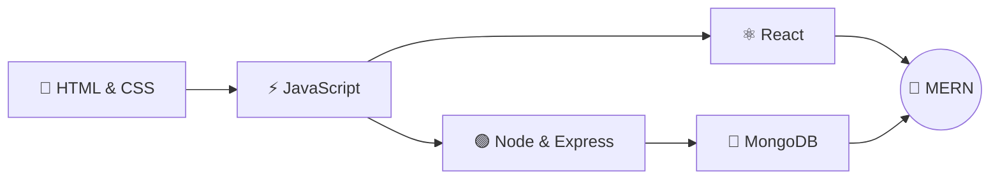

<div align="center">


<p>
  
  
  
  
  
  
  
</p>

**My hands-on work from the ITI MERN Stack track.**
Every front-end project is live on Vercel. Every back-end project is on GitHub.

<br/>

[🎨 HTML & CSS](#-html--css) ·
[⚡ HTML, CSS & JS](#-html-css--js) ·
[⚛️ React](#%EF%B8%8F-react) ·
[🟢 Node.js](#-nodejs) ·
[🗄️ Queries](#%EF%B8%8F-sql--nosql-queries)

</div>

<br/>

## 📊 At a Glance

<div align="center">

| 🌐 Live front-ends | 🔌 REST APIs | 🧩 Total projects |
|:---:|:---:|:---:|
| **5** | **2** | **7** |

</div>

---

## 🎨 HTML & CSS

> Responsive, pixel-careful landing pages built with pure markup and styling.

<table>
  <tr>
    <td width="50%" valign="top">
      <h3>🍔 Feane — Fast Food Restaurant</h3>
      <p>A responsive fast-food website with a hero carousel, a menu grid, table booking and a testimonials slider.</p>
      <p><b>Built with:</b> HTML · CSS · Bootstrap 5</p>
      <a href="https://iti-mern-projects-3dqscxfk4-eslam-alaa-s-projects.vercel.app"></a>
      <a href="https://github.com/Eslam-Alaa-ElDeen/ITI-MERN-projects/tree/main/HTML%26CSS/Feane%20%E2%80%94%20Fast%20Food%20Restaurant"></a>
    </td>
    <td width="50%" valign="top">
      <h3>🍝 Pato Place</h3>
      <p>An Italian restaurant landing page with events, customer reviews and a fully validated reservation form.</p>
      <p><b>Built with:</b> HTML · CSS · JavaScript</p>
      <a href="https://iti-mern-projects-fuwv-rdlap1igt-eslam-alaa-s-projects.vercel.app"></a>
      <a href="https://github.com/Eslam-Alaa-ElDeen/ITI-MERN-projects/tree/main/HTML%26CSS/Pato%20Place"></a>
    </td>
  </tr>
</table>

---

## ⚡ HTML, CSS & JS

> Adding real interactivity with vanilla JavaScript.

<table>
  <tr>
    <td valign="top">
      <h3>✅ Todoify — To-Do List</h3>
      <p>A minimal to-do app where you add tasks, tick them off and delete them. No frameworks, no dependencies.</p>
      <p><b>Built with:</b> HTML · CSS · Vanilla JS</p>
      <a href="https://iti-mern-projects-hxd6-5x22dtwog-eslam-alaa-s-projects.vercel.app"></a>
      <a href="https://github.com/Eslam-Alaa-ElDeen/ITI-MERN-projects/tree/main/HTML%26CSS%26JS"></a>
    </td>
  </tr>
</table>

---

## ⚛️ React

> Component-based user interfaces.

<table>
  <tr>
    <td width="50%" valign="top">
      <h3>💼 Eslam's Portfolio</h3>
      <p>A dark, futuristic developer portfolio with a particle background, scroll animations, a project filter and a contact form.</p>
      <p><b>Built with:</b> React · Vite · Tailwind CSS · Framer Motion</p>
      <a href="https://eslam-portfolio-mdm3.vercel.app/"></a>
      <a href="https://github.com/Eslam-Alaa-ElDeen/ITI-MERN-projects/tree/main/REACT/eslam-portfolio"></a>
    </td>
    <td width="50%" valign="top">
      <h3>📰 React Start</h3>
      <p>My first React project: a blog-style layout built from reusable header, post and tag components.</p>
      <p><b>Built with:</b> React · Create React App · CSS</p>
      <a href="https://reactstart-hzk9b3bpx-eslam-alaa-s-projects.vercel.app"></a>
      <a href="https://github.com/Eslam-Alaa-ElDeen/ITI-MERN-projects/tree/main/REACT/react_start"></a>
    </td>
  </tr>
</table>

---

## 🟢 Node.js

> Back-end REST APIs with Express and MongoDB.

<table>
  <tr>
    <td width="50%" valign="top">
      <h3>🛒 Shop App API</h3>
      <p>An e-commerce API with JWT auth, email OTP verification, role-based access, and product search, filtering and pagination.</p>
      <p><b>Built with:</b> Express 5 · MongoDB · JWT</p>
      <a href="https://github.com/Eslam-Alaa-ElDeen/ITI-MERN-projects/tree/main/NODE/shop_app"></a>
    </td>
    <td width="50%" valign="top">
      <h3>📝 Sticky Notes API</h3>
      <p>A notes API with user accounts, ownership checks, pagination and MongoDB aggregation lookups.</p>
      <p><b>Built with:</b> Express 5 · MongoDB · Mongoose</p>
      <a href="https://github.com/Eslam-Alaa-ElDeen/ITI-MERN-projects/tree/main/NODE/sticky-notes-api"></a>
    </td>
  </tr>
</table>

---

## 🗄️ SQL & NoSQL Queries

[`SQL-Query & noSQL-Query`](./SQL-Query%20%26%20noSQL-Query) holds my database practice: MongoDB queries (`mongoQuery.txt`) covering CRUD, filtering and aggregation.

---

## 🧭 Learning Path



---

## 📁 Repository Structure

```
ITI-MERN-projects/
├── HTML&CSS/
│   ├── Feane — Fast Food Restaurant/
│   └── Pato Place/
├── HTML&CSS&JS/
├── NODE/
│   ├── shop_app/
│   └── sticky-notes-api/
├── REACT/
│   ├── eslam-portfolio/
│   └── react_start/
├── SQL-Query & noSQL-Query/
│   └── mongoQuery.txt
└── .gitignore
```

---

<div align="center">

## 👋 Hi, I'm Eslam Alaa ElDeen

MERN Stack developer in training at ITI

[](https://github.com/Eslam-Alaa-ElDeen)
[](https://eslam-portfolio-mdm3.vercel.app/)

⭐ If you like these projects, give the repo a star!


</div>